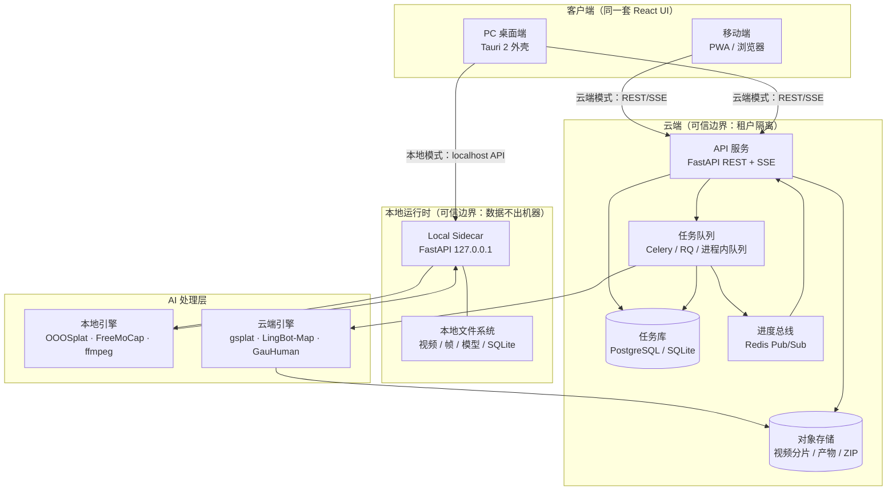
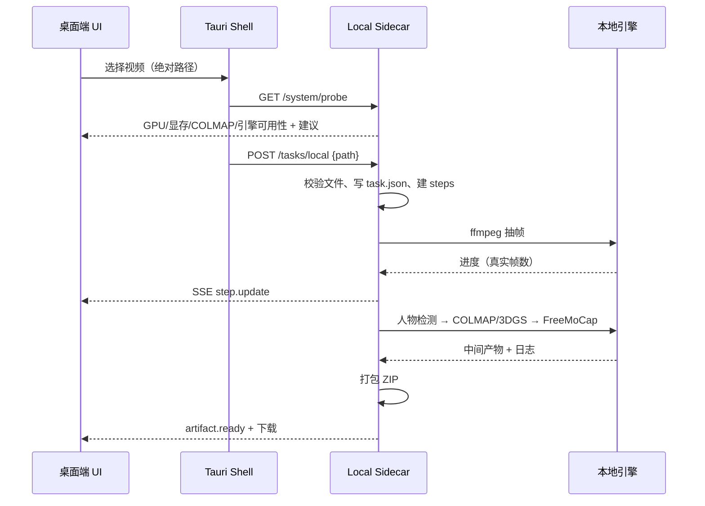
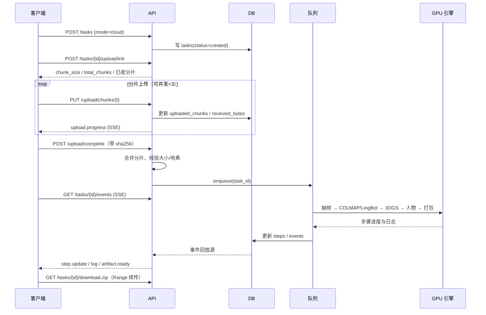

# VideoTo3D — 视频转 3D 场景 / 人物模型 / 动作数据

> 版本 v0.1（架构与接口基线）。本文档对应代码位于 `backend/`，前端目录预留在 `frontend/`。

## 0. 选型结论

| 议题 | 结论 | 理由 |
|---|---|---|
| 前端 | React 19 + TypeScript + Vite，单套代码 | 同一套页面同时用于 PC 与移动端；桌面用 Tauri 2 打包，移动端用 PWA |
| 本地模式 | Tauri 启动 **Python sidecar**（127.0.0.1，同一套 FastAPI） | 本地要跑 ffmpeg/COLMAP/3DGS，WebView 拿不到这些能力；sidecar 让本地与云端的 API/SSE 契约完全一致 |
| 云端后端 | FastAPI + Celery/RQ + Redis + PostgreSQL | MVP 用进程内队列 + SQLite，接口不变，后续替换实现即可 |
| 进度推送 | **SSE**（单向）+ HTTP 分片上传 | 进度是服务端 → 客户端单向流；SSE 经代理更省事，且支持 `Last-Event-ID` 断线回放；WebSocket 仅在未来需要双向控制时引入 |
| 上传 | 自定义分片续传（4 MiB/片），服务端记录已收分片 | 大视频断点续传、刷新后可续；不依赖第三方 tus 服务 |
| 状态存储 | SQLite（本地/单机）/ PostgreSQL（云）+ 每任务 `task.json` 快照 | 本地无需部署；云可多 worker；JSON 快照便于用户直接拷走或排查 |
| 引擎接入 | **适配器 + 子进程 / HTTP**，不在应用内重写算法 | OOOSplat、FreeMoCap、GauHuman、gsplat、LingBot-Map 各自有独立运行环境 |

### 0.1 引擎能力与合规矩阵（重要）

| 引擎 | 能力 | 建议运行位置 | 许可证 / 合规要点 | 集成形态 |
|---|---|---|---|---|
| OOOSplat | 环绕视频 → 3DGS（抽帧/COLMAP/训练/PLY） | **仅桌面本地**（Linux/Windows + NVIDIA，≥12 GB 显存建议） | 仓库许可证需在商用前核实；其依赖 COLMAP 为 BSD | 子进程执行工作流脚本，stdout 解析进度 |
| LingBot-Map | 单目视频流式重建，边处理边出中间结果 | **云端 GPU**（也可放进本地 GPU 机器） | 许可证需核实；模型权重许可单独确认 | HTTP 作业 + SSE/轮询进度 |
| gsplat | CUDA 加速 3DGS 训练/渲染库 | **云端 GPU**（本地亦可，但依赖 CUDA 工具链） | Apache-2.0；原始 3DGS 参考实现为研究/非商用许可，注意区分 | 子进程训练脚本 / 库调用，解析 iteration 进度 |
| FreeMoCap | 视频 → 人体 3D 关键点/动作（CSV、FBX、blend） | 桌面本地或云端 CPU/GPU 均可 | **AGPL-3.0**：进程隔离 + 独立分发 + 提供源码与许可声明；不得静态链接进闭源产品 | 独立 sidecar 可执行文件，文件交换 |
| GauHuman | 单目人体视频 + SMPL → 可驱动 3D 人体 | **仅云端 GPU**（训练 1–2 分钟级） | 仓库许可 + **SMPL/SMPL-X 体模授权**（多为非商用研究许可），商用需向 Max Planck 申请 | HTTP 推理服务，异步作业 |
| MediaPipe Pose | 人物存在性检测 + 2D 关键点（供筛选/驱动） | 本地 CPU 实时 | Apache-2.0 | 本地 Python 依赖 |

> 结论：**移动端不运行任何训练类引擎**。移动端只做“选片 + 上传 + 看进度 + 预览 + 下载”，本地重处理限定在桌面端。

---

## 1. 系统架构



- **一份 UI，两个 baseURL**：`http://127.0.0.1:8765`（本地 sidecar）或 `https://api.example.com`（云端）。前端不区分“本地/云端”的接口写法，只区分能力探测结果与可选引擎。
- **一份后端代码，两种部署**：本地以单进程 + 线程池队列运行；云端以多副本 API + Celery worker + Redis + PostgreSQL 运行。
- **进度只有一个真相源**：任务表里的 `steps` 状态机。前端进度条订阅 SSE，不做任何估算动画（除上传速度/ETA 由客户端基于真实字节数计算）。

---

## 2. 项目目录结构

```
video-to-3d/
├── docs/DESIGN.md                  # 本文档
├── backend/
│   ├── requirements.txt
│   ├── run_dev.sh                  # uvicorn 启动脚本
│   ├── app/
│   │   ├── main.py                 # 应用装配、CORS、启动恢复
│   │   ├── config.py               # 环境变量配置
│   │   ├── db.py                   # SQLAlchemy 引擎/会话
│   │   ├── models.py               # tasks / task_events / uploads / artifacts
│   │   ├── schemas.py              # 请求体与响应序列化
│   │   ├── api/
│   │   │   ├── tasks.py            # 建任务 / 列表 / 详情 / 取消 / 重试 / 删除
│   │   │   ├── upload.py           # 分片上传 / 续传状态 / 完成合并
│   │   │   ├── events.py           # SSE 流 + 日志回放
│   │   │   ├── artifacts.py        # 产物列表 / 单文件下载 / ZIP(Range)
│   │   │   └── system.py           # 硬件探测 / 引擎能力
│   │   ├── core/
│   │   │   ├── events.py           # EventBus + 事件持久化/节流
│   │   │   ├── progress.py         # 步骤表、权重、总体进度
│   │   │   ├── pipeline.py         # 流水线编排、断点恢复、取消
│   │   │   ├── packager.py         # manifest + viewer + zip
│   │   │   ├── probe.py            # GPU / CUDA / 引擎可用性探测
│   │   │   ├── storage.py          # 工作区目录与原子写
│   │   │   └── control.py          # 取消/暂停控制信号
│   │   ├── engines/
│   │   │   ├── base.py             # Engine 协议 + 子进程工具
│   │   │   ├── frames.py           # ffmpeg 抽帧（真实进度）
│   │   │   ├── detect.py           # MediaPipe 人物检测
│   │   │   ├── ooosplat.py         # 本地 3DGS 工作流适配
│   │   │   ├── gsplat.py           # 云端 3DGS 训练适配
│   │   │   ├── lingbot.py          # 流式重建 HTTP 适配
│   │   │   ├── freemocap.py        # AGPL 动捕适配（进程隔离）
│   │   │   ├── gauhuman.py         # 云端人物外观重建适配
│   │   │   └── mock.py             # 仅开发/联调用的模拟产物
│   │   └── workers/queue.py        # 任务队列（进程内实现，可换 Celery）
│   └── tests/smoke_e2e.py          # 端到端冒烟：建任务→分片上传→SSE→ZIP
├── frontend/                       # React 19 + TS + Vite（响应式 PWA）
│   ├── public/manifest.webmanifest # 可安装到桌面/主屏
│   ├── src/api/{client,stream,types}.ts
│   ├── src/pages/{Upload,TaskDetail,History}.tsx
│   └── src/components/{UploadProgress,StepTimeline,LogPanel,ModelViewer}.tsx
└── runtime/                        # 运行期数据（.gitignore）
    └── tasks/<task_id>/
```

每个任务的工作区：

```
runtime/tasks/<task_id>/
├── task.json          # 状态快照（可直接拷走排查）
├── input/video.mp4
├── upload/parts/*.part
├── frames/            # 抽帧结果
├── work/              # 引擎中间产物（COLMAP、checkpoints）
├── output/scene/      # scene.ply / scene.glb / scene.splat
├── output/person/     # person.glb / person.fbx
├── output/motion/     # motion.bvh / .fbx / .csv
├── output/preview/    # thumbnail.jpg / preview.mp4 / viewer.html
├── logs/pipeline.log
└── package/<task_id>.zip
```

---

## 3. 数据模型

### 3.1 服务端表（SQLite / PostgreSQL 通用）

```sql
CREATE TABLE tasks (
  id                TEXT PRIMARY KEY,          -- uuid hex
  mode              TEXT NOT NULL,             -- local | cloud
  status            TEXT NOT NULL,             -- created|uploading|queued|running|packaging|completed|failed|canceled|interrupted
  source_name       TEXT NOT NULL,
  source_size       INTEGER NOT NULL DEFAULT 0,
  source_sha256     TEXT,
  source_path       TEXT,                      -- 本地模式专用；云端为空
  video_path        TEXT,
  person_policy     TEXT NOT NULL DEFAULT 'auto',   -- auto|motion_only|appearance|none
  person_detected   INTEGER,                   -- NULL=未检测, 0/1
  current_step      TEXT,
  overall_progress  REAL NOT NULL DEFAULT 0,
  steps_json        TEXT NOT NULL DEFAULT '[]',    -- 步骤状态机（见 3.3）
  outputs_json      TEXT NOT NULL DEFAULT '{}',
  error_json        TEXT,
  engine_profile    TEXT NOT NULL DEFAULT 'auto',
  retry_count       INTEGER NOT NULL DEFAULT 0,
  created_at        TEXT NOT NULL,
  updated_at        TEXT NOT NULL,
  started_at        TEXT,
  finished_at       TEXT
);

CREATE TABLE task_events (                      -- 兼作 SSE 回放日志
  id          INTEGER PRIMARY KEY AUTOINCREMENT, -- SSE event id
  task_id     TEXT NOT NULL,
  type        TEXT NOT NULL,
  payload     TEXT NOT NULL,
  created_at  TEXT NOT NULL
);
CREATE INDEX idx_task_events_task ON task_events(task_id, id);

CREATE TABLE upload_sessions (
  task_id           TEXT PRIMARY KEY,
  chunk_size        INTEGER NOT NULL,
  total_bytes       INTEGER NOT NULL,
  total_chunks      INTEGER NOT NULL,
  uploaded_chunks   TEXT NOT NULL DEFAULT '[]',
  received_bytes    INTEGER NOT NULL DEFAULT 0,
  status            TEXT NOT NULL DEFAULT 'open',   -- open|completed|expired
  updated_at        TEXT NOT NULL
);

CREATE TABLE artifacts (
  id          INTEGER PRIMARY KEY AUTOINCREMENT,
  task_id     TEXT NOT NULL,
  kind        TEXT NOT NULL,        -- scene|person|motion|preview|log|package
  filename    TEXT NOT NULL,
  path        TEXT NOT NULL,
  mime        TEXT,
  size        INTEGER NOT NULL,
  sha256      TEXT,
  created_at  TEXT NOT NULL
);
```

云端再加：`users(id, email, password_hash)`、`task_owner(task_id, user_id)`（或直接在 `tasks` 上加 `owner_id` + 行级过滤），以及 `sessions`。

### 3.2 本地 JSON 快照（`task.json`，与表字段同构）

```json
{
  "schema_version": "1.0",
  "task_id": "0f7b2c...",
  "mode": "local",
  "status": "running",
  "source": { "name": "room.mp4", "size": 734003200, "sha256": null, "path": "/Users/x/room.mp4" },
  "person_policy": "auto",
  "person_detected": true,
  "current_step": "scene_reconstruct",
  "overall_progress": 0.42,
  "steps": [
    { "key": "extract_frames", "title": "视频抽帧", "status": "completed", "progress": 1.0,
      "detail": { "current": 360, "total": 360, "unit": "帧", "message": "已抽取 360 帧" },
      "started_at": "...", "finished_at": "..." },
    { "key": "camera_pose", "title": "相机位姿估计", "status": "completed", "progress": 1.0, "detail": { "message": "COLMAP 注册 412 张图" } },
    { "key": "scene_reconstruct", "title": "场景重建", "status": "running", "progress": 0.36,
      "detail": { "current": 2500, "total": 7000, "unit": "iter", "message": "3DGS 训练 2500/7000" } }
  ],
  "outputs": { "scene": "output/scene/scene.ply", "person": null, "motion": null, "preview": "output/preview/thumbnail.jpg", "package": null },
  "error": null,
  "created_at": "...", "updated_at": "..."
}
```

### 3.3 步骤状态机（唯一进度来源）

```json
{ "key": "extract_frames", "title": "视频抽帧", "status": "pending|running|completed|skipped|failed|canceled",
  "progress": 0.0, "weight": 8, "detail": { "current": 0, "total": 0, "unit": "帧", "message": "" },
  "error": null, "started_at": null, "finished_at": null }
```

`overall_progress = Σ(weight_i × progress_i) / Σ(weight of 非 skipped 步骤)`，只允许单调不减（代码里对已发布值取 `max`）。

---

## 4. 处理流程

### 4.1 本地模式（视频不出机器）



流程细节：

1. `probe`：检测 `ffmpeg`、`nvidia-smi`（型号/显存）、`colmap`、`torch.cuda`、`mediapipe`、OOOSplat 仓库路径、磁盘剩余空间。
2. 能力不足（无 GPU / 显存 < 8 GB / 无 COLMAP）→ 返回 `recommendation: "cloud"`，前端弹「本机算力不足，切换云端」并保留已选文件与参数。
3. 建任务（`mode=local`），**只登记路径，不复制不传网**；worker 直接读该路径。
4. 流水线、进度、取消与云端完全一致（同一 `pipeline.py`）。
5. 断点恢复：SQLite 中的 `steps_json` 为恢复依据；重启后 `queued/running` 任务标为 `interrupted`，用户点「继续」从最后一个未完成步骤续跑（已完成步骤校验产物存在后跳过）。

### 4.2 云端模式



上传进度字段由三处计算，全部基于真实字节：

- 服务端真值：`received_bytes / total_bytes`（`upload.progress` 事件 + `/upload/status`）。
- 客户端速率：滑动窗口 EMA，`speed = Δbytes / Δt`；`eta = 剩余字节 / speed`。
- 刷新恢复：`/upload/status` 返回已收分片，UI 直接从缺片继续；`init` 幂等。

流水线步骤与权重（`progress.py` 中定义）：

| key | 标题 | 权重 | 真实进度来源 |
|---|---|---|---|
| `prepare` | 任务校验与媒体解析 | 4 | ffprobe 时长/帧率 |
| `extract_frames` | 视频抽帧 | 8 | ffmpeg `-progress` 已抽帧数 |
| `detect_person` | 人物检测 | 5 | 已检测帧数 |
| `camera_pose` | 相机位姿估计 | 18 | COLMAP / 流式重建已注册帧 |
| `scene_reconstruct` | 场景重建 | 30 | 训练 iteration 计数 |
| `person_motion` | 人物动作提取 | 12 | FreeMoCap 阶段/帧数 |
| `person_appearance` | 人物外观重建 | 15 | GauHuman 训练轮次 |
| `texture_optimize` | 纹理优化 | 5 | 子步骤 |
| `export` | 模型导出与格式转换 | 5 | 文件转换进度 |
| `package` | 打包下载文件 | 3 | 已写入文件数 |

人物不存在时 `detect_person` 后把 `person_motion/person_appearance` 置 `skipped`，总权重自动重算（分母变化，进度跳升属正常）。

---

## 5. 前端页面与接口设计

### 5.1 页面

| 页面 | 关键内容 | 主要接口 |
|---|---|---|
| 首页 / 新建任务 | 拖拽选片、模式开关（本地/云端）、人物策略、硬件探测卡片 | `/system/probe`、`POST /tasks` |
| 上传页 | 分片进度条、已上传/总大小、速度、ETA、暂停/继续 | `/upload/init`、`PUT /upload/chunks/{i}`、`/upload/status`、`/upload/complete` |
| 任务详情 | 步骤时间线（真实状态）、日志面板、3D 预览、产物列表 | `GET /tasks/{id}`、`/events`、`/artifacts` |
| 历史记录 | 分组（进行中/已完成/失败）、恢复入口、删除 | `GET /tasks`、`POST /tasks/{id}/retry` |
| 下载 | ZIP 下载、断点续传、单文件下载 | `GET /download.zip`（Range）、`/artifacts/{id}` |

上传页状态机：`idle → probing → creating → uploading ⇄ paused → verifying → queued`；任一步失败进入 `error` 并可重试，不伪造进度。

### 5.2 接口清单（`/api/v1`，本地与云端一致）

```
POST   /tasks                          创建任务 {mode, source_name, source_size, person_policy}
POST   /tasks/local                    本地建任务 {path}
GET    /tasks?status=&mode=&limit=&offset=
GET    /tasks/{id}                     详情（含 steps / outputs / error）
POST   /tasks/{id}/cancel
POST   /tasks/{id}/retry               从失败/中断处继续
DELETE /tasks/{id}
POST   /tasks/{id}/upload/init         返回 chunk_size,total_chunks,uploaded_chunks
PUT    /tasks/{id}/upload/chunks/{i}   二进制分片，可重复提交（幂等）
GET    /tasks/{id}/upload/status
POST   /tasks/{id}/upload/complete     {sha256?}
GET    /tasks/{id}/events              SSE，支持 Last-Event-ID
GET    /tasks/{id}/logs?after=        非流式日志（分页/回放）
GET    /tasks/{id}/artifacts
GET    /tasks/{id}/artifacts/{aid}    单文件（attachment）
GET    /tasks/{id}/download.zip       Range 断点续传
GET    /system/probe                   硬件 + 引擎能力 + 建议
```

前端类型（节选）：

```ts
type TaskStatus = 'created'|'uploading'|'queued'|'running'|'packaging'|'completed'|'failed'|'canceled'|'interrupted';
type StepStatus = 'pending'|'running'|'completed'|'skipped'|'failed'|'canceled';
interface Step { key: string; title: string; status: StepStatus; progress: number; weight: number;
                 detail: { current?: number; total?: number; unit?: string; message?: string };
                 error?: string | null }
interface TaskDetail { id: string; mode: 'local'|'cloud'; status: TaskStatus; person_policy: string;
                       person_detected: boolean | null; current_step: string; overall_progress: number;
                       steps: Step[]; outputs: Record<string, string | null>;
                       error: { code: string; message: string; retryable: boolean; suggestion?: string } | null;
                       source: { name: string; size: number }; created_at: string; updated_at: string }
```

### 5.3 上传实现要点

- 分片并发 3、单片 4 MiB；每片用 `XHR` 才能拿到 `upload` 事件（`fetch` 不支持上传进度）。
- `PUT` 前先 HEAD/查询 `upload/status`，已存在的分片跳过（幂等 → 支持刷新后继续）。
- 速度用最近 5 个分片完成的滑动窗口，ETA 用 `remaining / ema`，显示为「约 2 分 10 秒」而不是假进度条动画。
- 服务端在合并后校验总大小与 `sha256`；不一致返回 `409` 且任务回到 `uploading`。

---

## 6. SSE 进度推送协议

### 6.1 传输

```
GET /api/v1/tasks/{id}/events
Accept: text/event-stream
Last-Event-ID: 1234        # 浏览器自动带；也支持 ?last_event_id=
```

响应头：`Content-Type: text/event-stream`, `Cache-Control: no-cache`, `X-Accel-Buffering: no`。

### 6.2 事件信封

```
id: 1024
event: step.update
data: {"id":1024,"type":"step.update","task_id":"...","ts":"2026-10-31T05:00:00.000Z","data":{...}}

: heartbeat 2026-10-31T05:00:15Z
```

### 6.3 事件表

| `event` | 触发 | `data` |
|---|---|---|
| `snapshot` | 连接后（无 `Last-Event-ID` 时） | `{task, steps, logs:最近50条}` 用于整页恢复 |
| `task.status` | 状态跃迁 | `{status, current_step, error}` |
| `task.progress` | 总体进度变化（≥1% 或状态变化） | `{overall, current_step}` |
| `step.update` | 步骤状态/子进度（节流 250ms） | `{key, title, status, progress, detail:{current,total,unit,message}, overall}` |
| `upload.progress` | 分片落盘后 | `{received_bytes, total_bytes, percent, chunk_index, total_chunks}` |
| `log` | 引擎输出行 | `{level, step, message}` |
| `artifact.ready` | 产物写入 | `{artifact_id, kind, filename, size, download_url}` |
| `task.error` | 失败 | `{code, message, retryable, suggestion}` |

### 6.4 可靠性

- 每个事件落库 `task_events`，`id` 即 SSE id。重连带 `Last-Event-ID` → 服务端从该 id 之后回放，再转入实时订阅。
- 无 `Last-Event-ID` → 只发 `snapshot`（快照即全量真值），避免重复回放造成 UI 闪烁。
- `step.update` 按 250ms 节流；状态跃迁、日志、产物事件立即发送。
- 心跳 15s 注释行，穿透反代 60s 超时；客户端 3 次未收到任何字节则重连并带 `Last-Event-ID`。
- 云端多副本：`EventBus` 换 Redis Pub/Sub，本地实现保持不变（同一接口）。

---

## 7. 人物检测与人物模型提取调度

### 7.1 决策树

```
抽帧完成
  └─> 人物检测（MediaPipe Pose，抽样 max(24, 帧数/12) 帧）
        ├─ 有人比例 ≥ 30% ──> person_detected = true
        │     ├─ policy = motion_only ──> FreeMoCap（本地/CPU）
        │     ├─ policy = appearance  ──> FreeMoCap（骨骼驱动）+ GauHuman（外观）
        │     ├─ policy = auto ────────> 按算力：
        │     │     ├─ 本地 GPU ≥ 12GB 且引擎可用 → FreeMoCap + GauHuman(本地受限) / 云端
        │     │     ├─ 本地 GPU < 8GB 或 无 FreeMoCap → 只做动作（轻量），外观建议上云
        │     │     └─ 移动端本地 → 禁止，引导切云端
        │     └─ policy = none ─────────> 跳过
        ├─ 比例 < 30% ──> person_detected = false，人物步骤 skipped
        └─ 检测器不可用 ──> person_detected = null
              ├─ policy 显式要求人物 → 步骤 failed，error.suggestion="安装 mediapipe 或切换云端"
              └─ policy = auto → 按无人处理，写 warning 日志
```

### 7.2 伪代码（`core/pipeline.py` + `engines/*`）

```python
# 检测阶段（真实抽样帧，非全片）
person_ratio, keypoints = detect_person(frames_dir, sample=max(24, n_frames // 12))
person = person_ratio >= 0.30

# 计划阶段：运行中动态改写步骤表
if not person:
    skip("person_motion"); skip("person_appearance")
elif policy == "motion_only" or not supports_appearance(device):
    skip("person_appearance")
    run("person_motion", freemocap_adapter)
elif policy in ("appearance", "auto"):
    run("person_motion", freemocap_adapter)         # 骨骼/动作
    run("person_appearance", gauhuman_adapter)      # 外观（仅云端 GPU）

# 动作输出：csv 始终产出；bvh/fbx 需 Blender 或 freemocap 自带导出
# 外观输出：person.glb（GauHuman 渲染 + 贴图），失败降级为“仅动作 + 场景”
```

规则：

- **只跑一次检测**：结果写入 `person_detected` 与 `outputs.person_source`，重试复用，避免重复消耗 GPU。
- **降级优先**：`person_appearance` 失败不使整个任务失败 → 标 `skipped` + `warning`，仍交付场景 + 动作。
- **合规隔离**：FreeMoCap 以独立可执行文件（独立容器/进程）调用，通过文件与 CLI 交换数据；不链接其代码、不打包进闭源安装包，随包附 AGPL 源码与许可声明。
- **SMPL 授权**：GauHuman 路径默认关闭，需在配置中显式启用（`V3D_ENABLE_SMPL=true`）并在 UI 提示“需自行获得体模授权”。

---

## 8. 打包下载结构

```
<task_id>.zip
└── <task_id>/
    ├── manifest.json
    ├── README.txt
    ├── LICENSE_NOTICES.md
    ├── scene/
    │   ├── scene.ply            # 3DGS 模型（主产物）
    │   ├── scene.glb            # 网格化（有则给）
    │   └── scene.splat          # 浏览器友好压缩格式（可选）
    ├── person/
    │   ├── person.glb           # 带贴图人体
    │   └── person.fbx           # 可选
    ├── motion/
    │   ├── motion.bvh
    │   ├── motion.fbx
    │   └── motion.csv
    ├── preview/
    │   ├── thumbnail.jpg
    │   ├── preview.mp4
    │   └── viewer.html          # 拖入浏览器即可查看 GLB/PLY
    ├── logs/
    │   └── pipeline.log
    └── metadata/
        └── steps.json
```

`manifest.json`：

```json
{
  "schema_version": "1.0",
  "task": { "id": "...", "mode": "cloud", "created_at": "...", "source": { "name": "a.mp4", "size": 123, "sha256": "..." } },
  "engine": { "profile": "auto", "scene": "gsplat", "motion": "freemocap", "appearance": "gauhuman", "simulated": false },
  "person": { "detected": true, "sources": ["motion", "appearance"] },
  "artifacts": [
    { "path": "scene/scene.ply", "kind": "scene", "bytes": 2048, "sha256": "..." },
    { "path": "motion/motion.bvh", "kind": "motion", "bytes": 512, "sha256": "..." }
  ],
  "steps": [ { "key": "extract_frames", "status": "completed", "seconds": 12.3 } ],
  "licenses": [ { "component": "FreeMoCap", "license": "AGPL-3.0", "url": "..." } ]
}
```

下载侧：ZIP 支持 `Range`（服务端 `Accept-Ranges: bytes`，`206` 响应），浏览器/下载器可断点续传；云端对象存储预签名 URL 也需开启 Range（S3 默认支持）。

---

## 9. 代码落地状态

已实现并验证（`backend/`）：

- 任务生命周期 + 分片续传上传 + SSE（含 `Last-Event-ID` 回放）+ 步骤状态机 + 断点恢复 + ZIP 打包 + Range 下载 + 硬件探测。
- 真实能力：ffmpeg 抽帧与 ffprobe 解析（真实帧进度）、MediaPipe 检测（可选依赖）、OOOSplat/FreeMoCap/GauHuman/gsplat/LingBot-Map 的**子进程 / HTTP 适配器**。
- `V3D_ENGINE_MODE=mock` 时用模拟产物跑通全链路（仅用于联调，产物 `manifest.simulated=true` 明确标记）。
- `backend/tests/smoke_e2e.py` 通过：分片上传 → 流水线 → SSE 事件 → ZIP 内容 → Range 206 → 本地任务 → 取消任务。

已实现并验证（`frontend/`，React 19 + TS + Vite，响应式 PWA）：

- 三个页面：新建任务（模式切换 + 文件拖拽 + 硬件探测 + 人物策略）、任务详情（步骤时间线 + SSE 日志 + 产物 + 3D 预览）、历史记录（筛选/重试/取消/删除/断点恢复入口）。
- 分片上传：4 MiB/片（后端可配）、并发 3、XHR 真实字节进度、滑动窗口速度与 ETA、暂停/继续（依赖服务端已落盘分片幂等续传）、SHA-256（≤64 MiB 时计算）。
- SSE 客户端：fetch + ReadableStream 解析、`Last-Event-ID` 回传、2s 起指数退避重连、心跳忽略、快照整页恢复。
- 3D 预览：three.js 加载 `.glb/.ply`（OrbitControls），WebGL 不可用时降级为下载提示而不崩溃。
- 未包含 Tauri/Rust 外壳：`frontend/dist` 可直接由任意 WebView/浏览器承载；桌面端要使用**本地模式**时，由外壳把 Sidecar 的 `127.0.0.1:8765` 注入 `window.__V3D_API_BASE__`（或 `VITE_API_BASE`）并传入本机文件绝对路径。

未实现（下一步）：

- Tauri 桌面外壳与移动端打包（当前为响应式 PWA，可安装到主屏）。
- FreeMoCap/GauHuman 独立服务镜像与 Celery/Redis 生产部署编排。

## 10. 运行

```bash
# 后端
cd backend
pip install -r requirements.txt
V3D_ENGINE_MODE=mock ./run_dev.sh        # http://127.0.0.1:8765/docs
python tests/smoke_e2e.py                # 端到端冒烟（真实分片 + SSE + ZIP）

# 前端（另开终端）
cd frontend
npm install
npm run dev                              # http://127.0.0.1:5173（/api 已代理到 8765）
npm run build                            # 产物 frontend/dist
```

生产（本地）：`tauri` 启动 sidecar 时注入 `V3D_DATA_DIR`、`V3D_API_TOKEN`（仅本机回环，仍需 token 防止浏览器跨站访问），并把 sidecar 地址注入前端。
生产（云端）：API 多副本 + Celery worker（GPU 节点池）+ Redis + PostgreSQL + S3/OSS；`EventBus` 换 Redis Pub/Sub，`workers/queue.py` 换 Celery `send_task`；前端 `VITE_API_BASE` 指向 API 网关。
